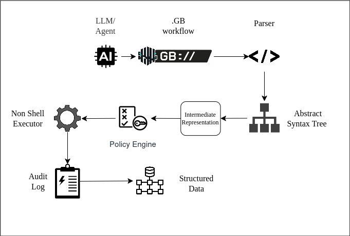
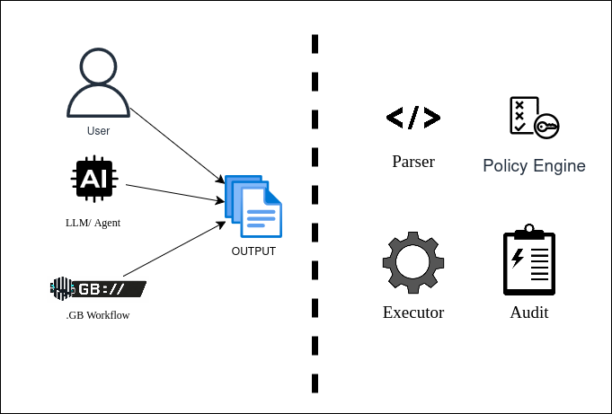
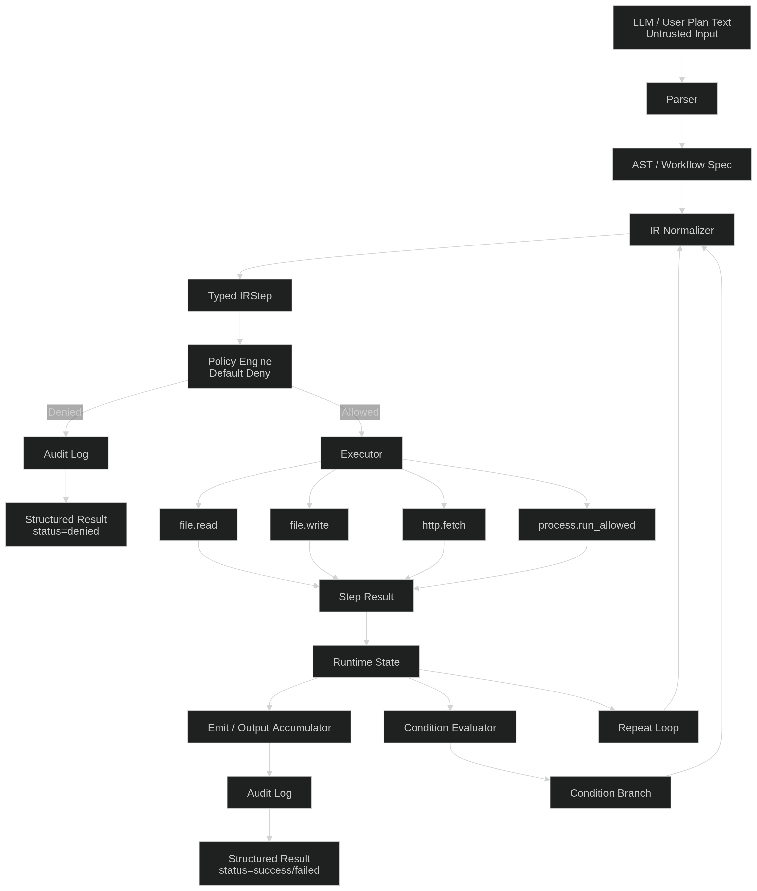

<p align="center">
  
</p>

# GuardBunny

**A policy-gated execution runtime for LLM-generated plans.**

GuardBunny sits between an LLM and your system.
It treats every plan as untrusted input, converts it into typed actions, checks each action against a policy, and executes only what is explicitly allowed.

> GuardBunny enforces policy constraints but is **NOT a hardened sandbox**.
> It reduces risk compared to direct LLM execution, but does not eliminate it.

---
## TL;DR

LLMs propose actions.

GuardBunny decides what actually runs.

It parses a workflow into typed actions, enforces a policy (default deny), and executes only allowed operations.

Think of it as a control layer between an LLM/agent and your system.

---

## What GuardBunny Is

* A **bounded execution runtime**
* A **typed action gateway (no free-form shell)**
* A **policy-enforced planner/executor boundary**

## What GuardBunny Is NOT

* Not a general-purpose programming language
* Not a prompt language
* Not a full agent framework
* Not a secure sandbox
* Not a guarantee of safety

---


## Core Model
<p align="center">
  
</p>

## Trust Boundary

<p align="center">
  
</p>

## Core Workflow




## Attack Flow

<p align="center">
  
</p>


**Key rule:**

> The LLM suggests. The runtime decides.

---

## Supported Actions (MVP)

| Action                | Description                             |
| --------------------- | --------------------------------------- |
| `file.read`           | Read file within allowed roots          |
| `file.write`          | Write file within allowed roots         |
| `http.fetch`          | HTTP request to allowed hosts           |
| `process.run_allowed` | Run allowlisted binaries (strict rules) |

---

## Quickstart

```bash
pip install -e ".[dev]"

mkdir -p /tmp/guardbunny
echo "hello world" > /tmp/guardbunny/test.txt
```

Run:

```bash

cat > /tmp/guardbunny/input.json <<'EOF'
{"file_path": "/tmp/guardbunny/test.txt"}
EOF

guardbunny examples/safe_read.gb \
  --policy policies/default_policy.yaml \
  --input /tmp/guardbunny/input.json
```

Run tests:

```bash
pytest tests/ -v
```

---

## Example Workflow

```yaml
version: "1.0"
name: "safe_read"

input:
  file_path:
    type: string

steps:
  - id: read_file
    do:
      action: file.read
      args:
        path: "${input.file_path}"
    emit:
      content: "${steps.read_file.result.content}"
```

---

## What GuardBunny Actually Enforces

These guarantees are backed by the current implementation:

* No `shell=True`
* No arbitrary shell execution
* No interpreter inline code (`python -c`, `bash -c`, etc.)
* Default-deny policy
* Per-step authorization
* Policy re-check on every loop iteration and condition branch
* Output size limits
* Execution timeouts (process + HTTP)
* Structured audit logging for every step

---

## What It Partially Enforces

These protections exist but are not complete:

* File path safety (TOCTOU race possible)
* Binary safety depends on policy quality
* Network safety limited to host allowlists
* Minimal condition expression safety

---

## What It Does NOT Protect Against

* **Malicious argv in allowed binaries**
  Example: `/usr/bin/grep` can read unintended files

* **Symlink race conditions (TOCTOU)**
  Path may change between policy check and execution

* **SSRF via allowed hosts**
  GuardBunny cannot see beyond first-hop requests

* **OS-level escape**
  No container, namespace, or seccomp isolation yet

* **Malicious file contents**
  No inspection of data being read or written

---

## Critical Warning: process.run_allowed

This is the primary remaining attack surface.

Even with allowlisted binaries:

* arguments are fully controlled by the caller
* many standard binaries expose powerful behaviors

For the MVP:

* keep the binary allowlist extremely small (1–3 binaries max)
* avoid filesystem traversal tools (`find`, etc.)
* avoid interpreters (`python`, `node`, etc.)
* consider disabling this action unless necessary

---

## Safe Usage Guidelines

* Treat all workflows as **untrusted input**
* Keep policy strict and minimal
* Prefer `file.*` and `http.fetch` over `process.run_allowed`
* Use small, controlled workspaces
* Inspect audit logs for every run
* Do not expose GuardBunny directly to untrusted users without additional isolation

---

## Current Limitations

* Input schema is parsed but **not enforced yet**
* Output schema is **not validated yet**
* No static validation CLI
* No OS-level sandbox
* Minimal DSL by design

---

## Repository Layout

```text
guardbunny/
  parser.py
  ir.py
  policy.py
  executor.py
  runtime.py
  audit.py
  cli.py

policies/
examples/
tests/
docs/
legacy/
```

---

## Roadmap (practical)

Near-term:

* input/output schema enforcement
* static validation CLI
* tighter argv restrictions
* improved audit detail

Mid-term:

* container / namespace isolation
* stricter filesystem model
* per-binary argument policies

---

## One-line summary

> GuardBunny makes LLM actions explicit, auditable, and policy-controlled — safer than raw execution, but not a complete security boundary.

---

## Status

Early-stage but functional.
Suitable for experimentation and controlled environments, not production-critical systems.
