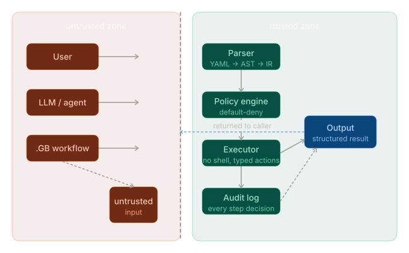
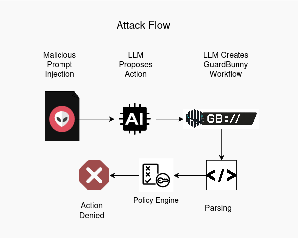

<p align="center">
  
</p>

# GuardBunny

**A policy-gated execution runtime for LLM- and agent-generated actions.**

GuardBunny sits between an untrusted planner (LLM/agent) and your system.
It converts proposed steps into typed actions, enforces a policy, and executes only what is explicitly allowed.

> GuardBunny enforces application-layer constraints.
> It is **not a hardened sandbox or OS-level isolation boundary**.

---

## TL;DR

LLMs propose actions.

GuardBunny decides what actually runs.

It parses a workflow into typed actions, enforces a policy (default deny), and executes only allowed operations.

Think of it as a control layer between an LLM/agent and your system.

---

## What GuardBunny Is

- A **bounded execution runtime**
- A **typed action gateway (no free-form shell)**
- A **policy-enforced planner/executor boundary**
- A **control boundary between planners and systems**

## What GuardBunny Is NOT

- Not a general-purpose programming language
- Not a prompt language
- Not a full agent framework
- Not a secure sandbox
- Not a guarantee of safety

---

## Core Model

<p align="center">
  
</p>

## Trust Boundary

<p align="center">
  
</p>

## Core Workflow


## Attack Flow

<p align="center">
  
</p>

**Key rule:**

> The LLM suggests. The runtime decides.

---

## Supported Actions

| Action | Description |
| --- | --- |
| `file.read` | Read file within allowed roots |
| `file.write` | Write file within allowed roots |
| `http.fetch` | HTTP request with host + scheme restrictions |
| `process.run_allowed` | Restricted subprocess execution (rule-based) |

---

## Quickstart

```bash
pip install -e ".[dev]"

mkdir -p /tmp/guardbunny
echo "hello world" > /tmp/guardbunny/test.txt

echo '{"file_path": "/tmp/guardbunny/test.txt"}' > input.json

guardbunny examples/safe_read.gb \
  --policy policies/default_policy.yaml \
  --input input.json
````

Run tests:

```bash
pytest tests/ -v
```

---

## Example Workflow

```yaml
version: "1.0"
name: "safe_read"

input:
  file_path:
    type: string

steps:
  - id: read_file
    do:
      action: file.read
      args:
        path: "${input.file_path}"
    emit:
      content: "${steps.read_file.result.content}"
```

---

## What GuardBunny Enforces (Backed by Code)

* No `shell=True`
* No direct shell execution
* Interpreter inline-code flags blocked (`-c`, `-m`, etc.)
* Default-deny policy
* Per-step authorization
* Policy re-check on every loop iteration and executed branch step
* Input schema validation before execution
* Output schema validation before success return
* Output size limits (file, HTTP, subprocess stdout/stderr)
* Execution timeouts (HTTP + subprocess)
* HTTP scheme allowlist (`http`, `https`)
* HTTP redirect following disabled
* Structured audit logging for:

  * action proposals
  * policy decisions
  * execution results
  * condition evaluations
  * runtime failures

---

## What It Partially Enforces

These protections exist but are not complete:

* File path safety (TOCTOU race possible)
* Binary safety depends on policy quality and strict `process_run_rules`
* Network safety limited to host allowlists
* Minimal condition expression safety

---

## What It Does NOT Protect Against

* **Malicious behavior inside allowed binaries**
  Example: a weak `process_run_rules` policy can still make an allowed binary unsafe.

* **Symlink race conditions (TOCTOU)**
  Paths may change between policy check and execution.

* **OS-level escape**
  No container, namespace, seccomp, AppArmor, or privilege isolation yet.

* **Malicious file contents**
  GuardBunny does not inspect the semantic safety of data being read or written.

* **General secure subprocess execution**
  `process.run_allowed` is restricted and rule-based, not a full secure command sandbox.

---

## Critical Warning: process.run_allowed

This is the highest-risk feature.

GuardBunny now enforces:

* per-binary argument validation
* allowed flag lists
* file operand extraction
* file root restrictions
* binary allowlisting

However:

> This is a **restricted execution model**, not a general secure subprocess system.

Recommended usage:

* keep the binary allowlist extremely small (1–3 binaries max)
* prefer `file.*` and `http.fetch` where possible
* avoid interpreters and traversal-heavy tools
* disable this action entirely if not needed

---

## Safe Usage Guidelines

* Treat all workflows as **untrusted input**
* Keep policy strict and minimal
* Prefer `file.*` and `http.fetch` over `process.run_allowed`
* Use small, controlled workspaces
* Inspect audit logs for every run
* Run under a low-privilege user
* Combine with external sandboxing for higher security

---

## Current Limitations

* Schema validation is runtime-enforced, but the DSL remains intentionally minimal
* No static validation CLI yet
* No OS-level sandbox yet
* Restricted subprocess support is explicitly narrow by design

---

## Repository Layout

```text
guardbunny/
  parser.py
  ir.py
  policy.py
  executor.py
  runtime.py
  audit.py
  cli.py

policies/
examples/
tests/
docs/
legacy/
```

---

## Roadmap

Near-term:

* static validation CLI (`guardbunny validate`)
* stronger subprocess rules
* improved audit completeness

Mid-term:

* OS-level isolation (containers / namespaces)
* stricter filesystem model
* improved policy ergonomics

---

## Security Model

### Untrusted

* workflows
* LLM outputs
* runtime inputs

### Trusted

* GuardBunny runtime
* policy configuration
* host OS environment

GuardBunny is a **runtime policy layer**, not a kernel- or container-level isolation mechanism.

---

## One-line Summary

> GuardBunny makes LLM actions explicit, constrained, and auditable — safer than raw execution, but not a complete security boundary.

---

## Status

Early-stage but functional.

GuardBunny is suitable for:

* controlled environments
* research and experimentation
* bounded execution pipelines

Not suitable for:

* high-security production environments (yet)

---

## Maintainer Note

This project is released for public use and improvement.

Active long-term maintenance is not guaranteed.

If you want to extend or harden it, fork it and build on it.

```
```
